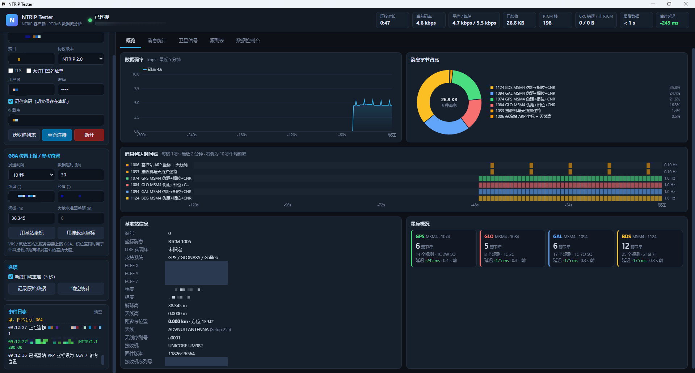
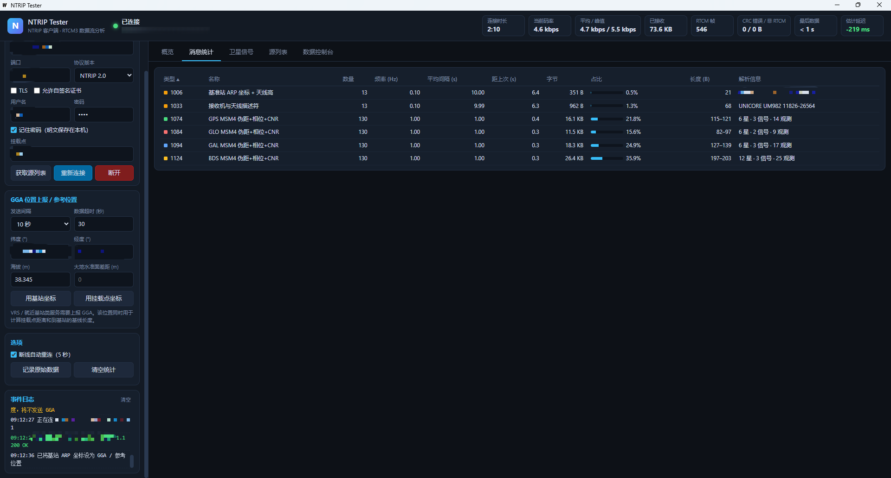

# NTRIP Tester

一个基于 [Wails](https://wails.io/)（Go + WebView）的桌面 NTRIP 客户端测试工具：连接 NTRIP Caster 的挂载点，实时解析 RTCM3 差分数据流，并对数据质量进行可视化分析。

功能设计参考了 [PyGPSClient](https://github.com/semuconsulting/PyGPSClient) 的 NTRIP 客户端。



## 功能

**NTRIP 连接**

- 支持 NTRIP 1.0（`ICY 200 OK`）与 NTRIP 2.0（HTTP/1.1，含 chunked 传输编码）
- 支持 TLS 以及自签名证书、HTTP Basic 认证
- 获取并解析源列表（STR / CAS / NET），按距离排序、关键字筛选，地图上展示挂载点分布
- 按固定间隔上报 GGA 位置（VRS / 就近基站类服务需要）
- 数据超时检测，断线后自动重连
- 原始数据流保存为 `.rtcm3` 文件

**RTCM3 解析与分析**

- 帧同步与 CRC-24Q 校验，统计 CRC 错误和非 RTCM 数据
- 按消息类型统计：数量、10 秒平均频率、平均间隔、距上次时间、字节占比、长度范围；超过 3 倍平均间隔未更新的消息会高亮提示
- 基准站信息：1005/1006 ARP 坐标（ECEF 与经纬度）、天线高，1007/1008/1033 天线与接收机、固件版本，以及到参考位置的基线距离和方位
- MSM1–7（GPS / GLONASS / Galileo / 北斗 / QZSS / SBAS / NavIC）：卫星数、信号种类（RINEX 观测码）、每颗卫星各频点的载噪比
- 基于观测历元估算数据延迟
- 星历覆盖：1019 / 1020 / 1041 / 1042 / 1044 / 1045 / 1046
- 1029 文本消息
- 逐帧数据控制台：支持暂停、过滤、十六进制显示

## 截图

**概览**：码率曲线、消息字节占比、消息到达时间线、基准站信息与星座概况


**消息统计**：各消息类型的数量、频率、间隔、字节占比与解析信息



## 下载

从 [Releases](../../releases) 页面下载对应平台的程序：

| 平台 | 文件 |
| --- | --- |
| Windows x64 | `ntrip-tester-<版本>-windows-amd64.exe`（单文件，可直接运行） |
| Linux x64 | `ntrip-tester-<版本>-linux-amd64.tar.gz` |
| macOS（Intel / Apple Silicon） | `ntrip-tester-<版本>-macos-universal.zip` |

Windows 需要 [WebView2 运行时](https://developer.microsoft.com/microsoft-edge/webview2/)，Windows 10/11 通常已自带。Linux 需要 `libgtk-3` 和 `libwebkit2gtk-4.0`。

## 使用

1. 填写 Caster 地址、端口、协议版本，以及用户名和密码（如需认证）。
2. 挂载点留空，点击 **获取源列表**，在「源列表」页中单击选择挂载点，双击可直接连接。
3. 如果服务要求上报位置（源列表中 GGA 列显示“需要”），填写经纬度并选择 GGA 发送间隔。
4. 点击 **连接**，在「概览」「消息统计」「卫星信号」「数据控制台」页查看分析结果。

说明：

- 估计延迟 = 本机时钟 − MSM 观测历元时间，结果受本机时间精度影响，建议开启系统自动对时。
- 连接配置保存在本机；只有勾选“记住密码”时才会保存密码，且为明文。
- 请遵守 NTRIP 服务的使用条款，避免频繁重连或同时建立过多连接。

## 从源码构建

依赖：

- Go 1.22+
- Wails CLI v2：`go install github.com/wailsapp/wails/v2/cmd/wails@latest`
- Windows：WebView2；Linux：`libgtk-3-dev`、`libwebkit2gtk-4.0-dev`

前端是原生 HTML/JS + Canvas，不需要 Node.js / npm。

```bash
go mod tidy
go test ./internal/...
wails dev      # 开发模式
wails build    # 输出到 build/bin/
```

Windows 下也可以直接运行 `build.bat` 一键测试并打包。

## 发布

推送 `v` 开头的标签后，GitHub Actions（`.github/workflows/release.yml`）会自动构建 Windows、Linux、macOS 三个平台的版本并发布到 Releases：

```bash
git tag v1.0.0
git push origin v1.0.0
```

标签名会写入程序版本号（窗口标题中显示）。带 `-` 的标签（如 `v1.1.0-beta.1`）会发布为预发布版本。

## 项目结构

```text
.
├── main.go                  # Wails 入口
├── app.go                   # 暴露给前端的方法与事件推送
├── internal/
│   ├── ntrip/               # NTRIP 客户端：连接、源列表、GGA、重连
│   ├── rtcm/                # RTCM3 分帧、CRC24Q、消息解码
│   ├── analyzer/            # 数据流统计与快照
│   └── geo/                 # 坐标转换与距离计算
├── frontend/dist/           # 界面（HTML / CSS / JS / Canvas 图表）
├── build.bat                # Windows 一键打包脚本
└── .github/workflows/       # 自动发布流程
```

## 致谢

- [PyGPSClient](https://github.com/semuconsulting/PyGPSClient) / [pygnssutils](https://github.com/semuconsulting/pygnssutils)：NTRIP 客户端功能设计参考
- [RTKLIB](https://github.com/tomojitakasu/RTKLIB)：MSM 信号编号与 RINEX 观测码对照
- [Wails](https://wails.io/)
